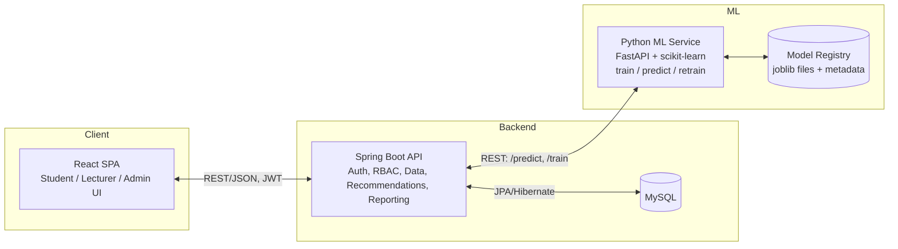

# AI-Based Student Performance Prediction & Improvement System — Build Plan

Source thesis: *Development of an AI-Based Student Performance Prediction and Improvement System — A Case Study of the University of Kigali* (Nteziryayo Alain Fabrice, BIT, University of Kigali).

The thesis (Chapters 1–5) specifies Django + MySQL + vanilla HTML/Bootstrap. This plan **deliberately deviates** from that stack per your instruction: **Spring Boot backend + React frontend**, built to be close to production-ready rather than a bare academic prototype. The functional requirements, database entities, ML algorithms, and evaluation approach are all kept faithful to the thesis (Sections 4.3–4.7) so the delivered system still matches what the thesis documents.

---

## 1. What the system must do (from the thesis)

- Continuously ingest attendance, continuous-assessment (CA) scores, and assignment completion — instead of waiting for final exams.
- Classify each student, per course/semester, into **Low / Medium / High** academic risk using **Decision Tree, Logistic Regression, and Naive Bayes** (Decision Tree is the thesis's chosen production model at 84.6% accuracy).
- Turn each prediction into a **personalized, actionable recommendation** (attendance, CA, or assignment-focused).
- Serve three role-based experiences: **Student**, **Lecturer**, **Administrator**.
- Support data upload/import, notifications on newly-flagged high-risk students, reporting/export (PDF/Excel), and periodic model retraining.
- Meet non-functional requirements: RBAC, HTTPS, modular/maintainable architecture, data-privacy (Rwanda Law No. 058/2021), audit trail of predictions.

---

## 2. Architecture decision

The thesis's ML choice (scikit-learn: Decision Tree / Logistic Regression / Naive Bayes) is Python-native — there's no equivalent-maturity Java library, and re-implementing/re-validating those exact algorithms in Java would throw away the thesis's methodology and results. Rather than force everything into one language, this plan uses a **small, clean microservice split**, which is itself a legitimate production pattern (Java for transactional/business logic, Python for ML):



- **Spring Boot** owns everything user-facing: auth, RBAC, student/course/attendance/assessment CRUD, recommendation engine, notifications, reporting/export, audit log. This is the system of record.
- **Python ML microservice (FastAPI + scikit-learn)** owns only: preprocessing, training the three classifiers, cross-validation, model comparison, and serving `/predict`. Spring Boot calls it over REST and stores the returned risk level + confidence score in its own `predictions` table — so the ML service is stateless/replaceable and the rest of the system doesn't care what's inside it.
- This mirrors Section 4.3.3's own requirement that "machine learning components must be built using Python and scikit-learn... integrated with the web application through a defined API" — the thesis already anticipated this exact split; we're just putting a modern Java backend in front of it instead of Django.

If you'd rather keep everything in one Java process (no separate ML service), the alternative is a Java ML library (e.g. Smile or Tribuo) reimplementing the three algorithms — flag if you want that instead; my default recommendation is the split above.

---

## 3. Tech stack

| Layer | Choice | Notes |
|---|---|---|
| Backend | **Spring Boot 3 (Java 21)** | Spring Web, Spring Data JPA, Spring Security + JWT, Bean Validation |
| ML service | **Python 3.11 + FastAPI + scikit-learn** | `/train`, `/predict`, `/metrics` endpoints; models persisted with `joblib` |
| Database | **MySQL 8** | matches thesis Data Dictionary (Tables 4–9) |
| Frontend | **React 18 + TypeScript + Vite** | TailwindCSS + shadcn/ui for a clean modern look; Recharts for dashboards; React Query for data fetching; React Router with role-based routes |
| Auth | JWT (access + refresh), BCrypt password hashing, role claims (`student`/`lecturer`/`admin`) | |
| Reporting | Apache POI (Excel), OpenPDF/iText (PDF) inside Spring Boot | |
| Infra (later) | Docker Compose (mysql, backend, ml-service, frontend) | one-command local spin-up, and a realistic path to real deployment |

---

## 4. Database schema (adapted from Chapter 4 Data Dictionary)

Core tables, normalized to 3NF as in the thesis:

- **users** — id, full_name, email, password_hash, role (student/lecturer/admin), status, created_at
- **students** — id, user_id (FK), registration_no, program, year_of_study, previous_gpa
- **courses** — id, course_code, course_name, credits
- **enrollments** — id, student_id (FK), course_id (FK), semester *(added — thesis's ERD implies this but Ch.4 only lists a subset; needed to relate students↔courses↔semester cleanly)*
- **attendance** — id, student_id (FK), course_id (FK), semester, sessions_attended, sessions_total
- **assessments** — id, student_id (FK), course_id (FK), semester, ca_score, assignment_completion, final_score
- **predictions** — id, student_id (FK), course_id (FK), model_used, risk_level, confidence_score, generated_at
- **recommendations** — id, prediction_id (FK), category, message, status (active/acknowledged)

This maps 1:1 onto the CSVs generated in step 5 below, so the dataset can seed the database directly once the backend exists.

---

## 5. Sample dataset (generated now)

Location: `dataset/` in the project root. Synthetic, fixed random seed (42), fictional names — safe to commit and use for development, seeding, and ML training/demo.

| File | Rows | Purpose |
|---|---|---|
| `students.csv` | 420 | id, registration_no, full_name, email, program, year_of_study, previous_gpa |
| `courses.csv` | 15 | id, course_code, course_name, credits |
| `enrollments.csv` | 1,698 | student × course × semester links |
| `attendance.csv` | 1,698 | sessions_attended / sessions_total per student-course-semester |
| `assessments.csv` | 1,698 | ca_score, assignment_completion, final_score |
| `ml_training_dataset.csv` | 1,698 | flattened, ML-ready: attendance_rate, ca_score, assignment_completion, previous_gpa → **risk_level** label |

Risk labels were generated from rule/threshold logic over the four predictive features (matching Section 4.5.1's feature set — e.g. a hard attendance or CA cutoff forces High risk regardless of other scores), plus an ~20% random one-step label-noise rate, so the data isn't trivially separable and a Decision Tree doesn't just memorize it. Current label distribution: **High 677 / Medium 560 / Low 416**.

**Validated against Table 10 of the thesis** — I trained the same three algorithms (70/30 split, 10-fold CV) directly on `ml_training_dataset.csv` as a sanity check:

| Algorithm | Accuracy | Precision | Recall | F1 | 10-fold CV |
|---|---|---|---|---|---|
| Decision Tree | 80.6% | 80.9% | 80.9% | 80.9% | 83.4% |
| Logistic Regression | 75.0% | 74.5% | 74.4% | 74.5% | 76.2% |
| Naive Bayes | 72.4% | 72.0% | 72.9% | 72.2% | 73.2% |

(Thesis Table 10, for comparison: Decision Tree 84.6% / Logistic Regression 81.3% / Naive Bayes 77.8%.) Same ranking, same rough magnitude and spread — close enough to be a credible stand-in for real institutional data, without being suspiciously perfect.

If you want a different size, a different risk-label rule, tighter/looser accuracy matching, or per-department skew, tell me and I'll regenerate — the generator script is reusable and seeded for reproducibility.

---

## 6. Backend module plan (Spring Boot)

- `auth` — signup (admin-provisioned), login, JWT issue/refresh, role guard
- `user` — user + role management (admin only)
- `academic` — students, courses, enrollments CRUD/import
- `data-ingest` — attendance/CA/assignment CSV or form upload, validation, cleaning
- `ml-client` — REST client to the Python ML service (`/predict`, `/train`), retry/timeout handling
- `prediction` — persists predictions, exposes per-student/per-course/per-cohort views
- `recommendation` — rule-based mapping from a prediction's weak feature(s) → recommendation message(s)
- `notification` — flags newly high-risk students, in-app (and optionally email) alert
- `reporting` — aggregated analytics, PDF/Excel export for admins
- `audit` — read-only log of every prediction/recommendation generated (transparency requirement, Section 4.3.3)

## 7. ML service plan (FastAPI + scikit-learn)

- `preprocessing.py` — missing-value handling, encoding, normalization (mirrors Section 4.5.2)
- `train.py` — trains Decision Tree / Logistic Regression / Naive Bayes on `ml_training_dataset.csv`-shaped input, 70/30 split, 10-fold CV, saves each model + a comparison report (accuracy/precision/recall/F1 — reproducing Table 10)
- `predict.py` — loads the selected production model (Decision Tree, matching the thesis's own choice) and serves single or batch predictions with a confidence score
- `POST /train` — retrain on latest exported data (admin-triggered, matches "Model Retraining" functional requirement)
- `POST /predict` — `{ attendance_rate, ca_score, assignment_completion, previous_gpa }` → `{ risk_level, confidence, model_used }`
- `GET /metrics` — last training run's accuracy/precision/recall/F1 per algorithm, for the admin dashboard

## 8. Frontend plan (React)

- `/login` — role-aware login
- `/student` — my risk level, trend over time, my recommendations
- `/lecturer` — my courses → at-risk student list, filters, drill into a student
- `/lecturer/upload` — attendance/CA/assignment upload
- `/admin` — cohort/department/program analytics, model performance panel, user management, report export
- Shared: clean card/table components, charts (risk distribution, trend lines), toast notifications for new high-risk flags, responsive layout (desktop + mobile, per Section 4.3.3's cross-platform requirement)

## 9. Security plan

- JWT auth, BCrypt-hashed passwords, role-based route guards on both API and frontend
- HTTPS everywhere (dev: self-signed / mkcert; prod: real cert)
- Parameterized queries via JPA (no raw SQL string concatenation) → SQL-injection safe by construction
- Input validation (Bean Validation annotations + frontend form validation) and output escaping (React escapes by default) → XSS safe by construction
- Student data anonymized before being sent to the ML service for training (send only the four numeric features + label, never name/email)

## 10. Testing plan (mirrors Chapter 4.7's Table 11)

- Backend: unit tests per service (JUnit + Mockito), integration tests per controller (Spring Boot Test + Testcontainers for MySQL)
- ML service: unit tests for preprocessing edge cases (missing values), model-load smoke test, accuracy regression test (fail CI if retrained model drops far below the ~80% baseline)
- Frontend: component tests (Vitest + React Testing Library) for dashboards and forms
- Security: automated checks for SQL injection / XSS on all input forms (matches TC-10)
- End-to-end: one Playwright/Cypress flow per role (login → dashboard → key action)

---

## 11. Repo structure

```
fabrice/
├── dataset/                  # done — synthetic CSVs
├── backend/                  # Spring Boot (Java)
├── ml-service/               # FastAPI + scikit-learn
├── frontend/                 # React + TypeScript
├── docker-compose.yml        # mysql + backend + ml-service + frontend
└── PROJECT_PLAN.md           # this file
```

## 12. Delivery phases

1. **Foundation** — ✅ done. Repo scaffolded for all three services, docker-compose, MySQL schema via Flyway, CSV-based seeding from `dataset/`.
2. **ML core** — ✅ done. Training pipeline reproduces Table 10 closely (Decision Tree 84.1% vs thesis 84.6%, same ranking DT > LR > NB); `/predict`, `/train`, `/metrics` all working.
3. **Backend core** — ✅ done. JWT auth/RBAC (including object-level "do you own this course" checks), full CRUD, ML-client with automatic fallback if the ML service is down, prediction + recommendation persistence.
4. **Frontend core** — ✅ done. Student/Lecturer/Admin dashboards wired to real endpoints, CSV upload flow, risk-distribution charts (dataviz-skill-validated status palette).
5. **Hardening** — ✅ done. Notifications (student + lecturer, newly-high-risk triggered), audit trail (admin, all predictions/recommendations traceable), PDF/Excel analytics export, mobile-responsive nav with a collapsible drawer.
6. **Validation** — ✅ done. Automated test suites recreating Table 11 across all three services (see below), not just a manual smoke test.

Each phase ends with something runnable you can look at before the next one starts, rather than one big-bang delivery at the end.

### Automated test coverage (Phase 6)

- **Backend** (`backend/src/test/...`, JUnit 5 + MockMvc + H2): 17 tests across `AuthControllerTest` (TC-01, TC-02, TC-10 -- including a direct repository-level proof that an injection payload is treated as an inert literal, not SQL), `LecturerControllerTest` (TC-05, TC-06, TC-07 + object-level RBAC), `DataUploadServiceTest` (TC-03, TC-04, TC-09 concurrent uploads via a thread pool), `AdminControllerTest` (TC-08 + report export content-types), `PredictionServiceTest` (risk categorization + notification triggering). Run: `mvn test`.
- **ML service** (`ml-service/tests/`, pytest): 11 tests covering preprocessing (missing-value repair), an accuracy regression guard against the ~84% baseline, Decision-Tree-is-selected-as-active assertion, and API-level contract tests (`/health`, `/predict` incl. input-range rejection, `/metrics`, `/train`). Run: `./.venv/Scripts/python -m pytest`.
- **Frontend** (Vitest + React Testing Library): tests for `RiskBadge` (label always present, never color-alone), `LoginPage` (server error surfaced, required fields), `ProtectedRoute` (unauthenticated redirect). One of these caught a real accessibility bug -- the login form's `<label>`s weren't associated with their inputs via `htmlFor`/`id`, fixed. Run: `npm test`.

### What's been verified end-to-end (manual smoke test, H2 in-memory DB + live ML service)

- Backend boots, Flyway migrations apply cleanly, `DataSeeder` loads all 431 users / 420 students / 15 courses from `dataset/`.
- Login works for admin/lecturer/student roles with the seeded demo passwords.
- Lecturer → generate predictions for a course → real Decision Tree predictions come back (confirmed `modelUsed: "decision_tree"`, not the fallback) and recommendations are generated per weak feature.
- RBAC object-level check confirmed: a lecturer got a 403 trying to touch a course they don't teach.
- Admin analytics aggregates correctly by risk level, program, and course; `/admin/ml/metrics` passes through the ML service's real Table-10-style metrics.
- Newly-high-risk predictions correctly notify both the student and their course's lecturer; mark-as-read works and is ownership-checked.
- Admin audit trail lists every prediction with its recommendations, most recent first.
- Both PDF and Excel analytics exports download as valid, well-formed files (verified with `file`: "Microsoft Excel 2007+" / "PDF document, version 1.5").
- Frontend builds clean (`npm run build`) and its dev-server `/api` proxy was confirmed reaching the live backend.
- Caught and fixed two real bugs in this pass: (1) `MlPredictRequest` wasn't sending snake_case JSON to the Python service, so every prediction was silently using the rule-based fallback instead of the trained model -- fixed via `@JsonProperty` mapping; (2) the login form's labels weren't accessibly associated with their inputs -- fixed via `htmlFor`/`id`.

### Confirmed on the real `docker compose up` stack (real MySQL 8.4, not H2)

All four containers (`mysql`, `ml-service`, `backend`, `frontend`) built and started cleanly. Re-ran the full smoke test against this real stack and everything matched the earlier H2-based results:
- Both Flyway migrations applied against real MySQL; `DataSeeder` loaded all 431 users/420 students/15 courses over the network in ~90s (vs ~3s for in-memory H2 -- expected).
- Login, prediction generation (real `decision_tree` model via the containerized ML service, not the fallback), notifications (student + lecturer), audit trail, and both PDF/Excel report exports all verified working via curl against `localhost:8080`.
- Frontend's production nginx `/api` proxy (`localhost:5173` -> container `backend:8080`) confirmed working, not just the Vite dev-server proxy used earlier.
- One environment-specific hiccup, not a code issue: host port 8080 was briefly occupied by an unrelated process on the dev machine, causing the first `docker compose up -d` to fail on the backend container; resolved once that port was freed.

---

## Architecture decision — resolved

Went with the Spring Boot + Python-ML-microservice split (as recommended in §2), not a pure-Java reimplementation. This is now implemented and validated above.
